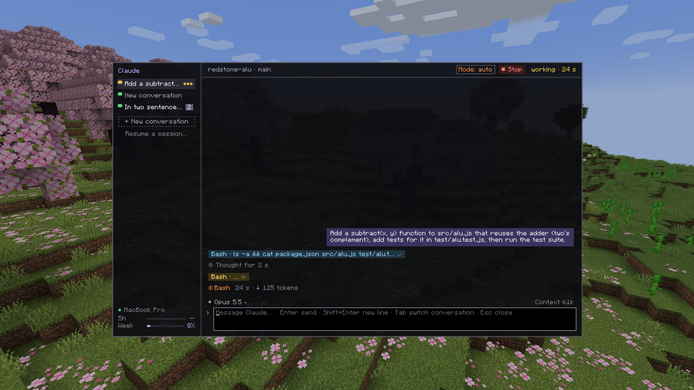
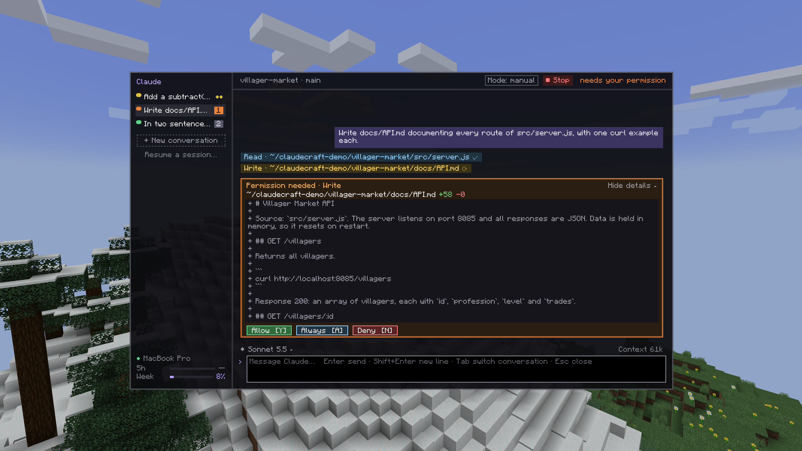
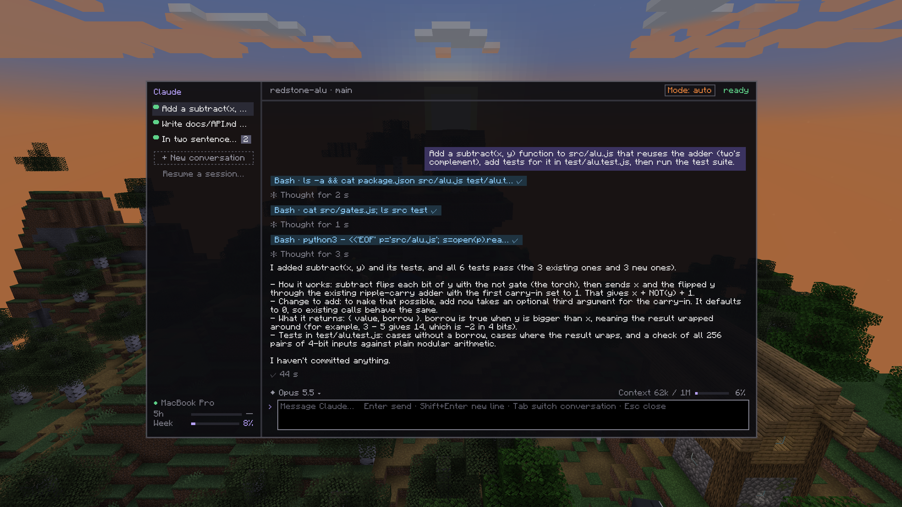
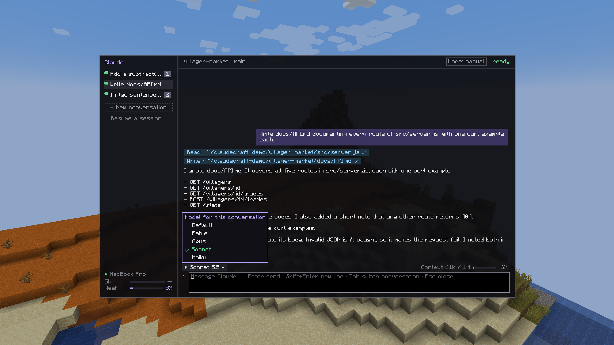
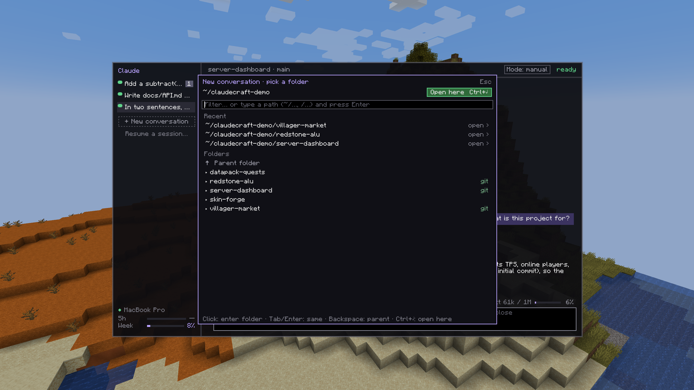

# ClaudeCraft

**Want to keep grinding on your projects, even during your two-week Minecraft phase?**

[](https://github.com/hzllfeu/claudecraft/actions/workflows/build.yml)

ClaudeCraft is a Fabric mod that brings [Claude Code](https://docs.anthropic.com/en/docs/claude-code) into Minecraft. You talk to your
own `claude` CLI, running on your own machine with your own login, from an in-game screen: several conversations at
once, live progress, permission prompts, model choice, context and plan usage.



| | |
|---|---|
|  |  |
| Permission requests, with a preview of the change | Answers, tool calls and thinking |
|  |  |
| One model per conversation, context window usage | Start a conversation in any folder |

## How it works

```
 game client ── client mod: the Claude screen (key C)
      │  Minecraft packets
 Minecraft server ── server mod: relays events, runs no Claude at all
      │  127.0.0.1:25580, one token per player, reached through an SSH tunnel
 your machine ── bridge (Node.js): runs `claude -p --output-format stream-json` with your login
```

The server only relays JSON lines between a player and that player's bridge. Each player links their own machine and
their own Claude Code account, and nobody sees anyone else's conversations. The bridge turns the CLI's stream into
messages, tool calls and progress for the game, and answers the CLI's permission requests through a small MCP server
(`bridge/perm-mcp.mjs`, used as `--permission-prompt-tool`) that waits for the player's decision.

Without the client mod, everything still works through `/claude` chat commands with clickable buttons.

## Requirements

- Server: Fabric for Minecraft 1.21.1, Fabric API, Java 21.
- Game client (optional, for the screen): the same jar and Fabric API.
- Your machine: Node.js 20 or later, Claude Code installed and logged in, SSH access to the server.

## Installation

1. Download `claudecraft-<version>.jar` from the [releases](https://github.com/hzllfeu/claudecraft/releases), or build
   it (see [Development](#development)).
2. Put it in the server's `mods/` folder and restart. The mod listens on `127.0.0.1:25580` only; the port can be
   changed in `config/claudecraft.json`.
3. Put the same jar in your client's `mods/` folder to get the screen.
4. On the machine where Claude Code is logged in:

   ```bash
   git clone https://github.com/hzllfeu/claudecraft.git
   cd claudecraft/bridge
   cp config.example.json config.json
   ```

5. In game, run `/claude link`, click **[Copy]** and paste the token into `config.json` along with your SSH details.
   Then start the bridge:

   ```bash
   node bridge.mjs
   ```

The bridge opens the SSH tunnel itself, reconnects after network or server restarts and, on macOS, prevents idle sleep
while it runs. To run it in the background at login on macOS, see
[`bridge/launchd/claudecraft-bridge.plist.example`](bridge/launchd/claudecraft-bridge.plist.example).

Running `/claude link` again issues a new token and revokes the previous one. Operators can link another player, or
the server console, with `/claude link <player>`.

### Bridge configuration

| Key | Default | |
|---|---|---|
| `host`, `user`, `sshKey` | | SSH access to the Minecraft server |
| `token` | | token given by `/claude link` |
| `remotePort`, `localPort` | `25580`, `25581` | mod port on the server, local end of the tunnel |
| `claudePath` | `claude` | path to the Claude Code CLI |
| `defaultCwd` | `~` | folder used when none is given |
| `hostLabel` | hostname | name of this machine as shown in game |
| `promptPrefix` | `""` | text prepended to every message, for example to ask for short answers |
| `permTimeoutSec` | `300` | permission requests left unanswered are denied after this delay |
| `keepAwake` | `true` | macOS only: run `caffeinate -i` while the bridge runs |
| `direct` | `false` | connect to `host:remotePort` without SSH, for a local test server |

## Usage

Press **C** to open the screen.

| Key | Action |
|---|---|
| Enter, Shift+Enter | send, new line |
| ↑ ↓ | message history |
| Tab, Shift+Tab, Ctrl+1…9 | switch conversation |
| Ctrl+T, Ctrl+W | new conversation (folder picker), close conversation |
| Ctrl+M | cycle the permission mode |
| Ctrl+E | resume an existing Claude Code session |
| Ctrl+. | stop the current turn |
| Y, A, N | allow, always allow, deny the pending request (when the input is empty) |
| Right click | copy a message |

The line above the input shows the conversation's model (click it to change) and how full its context window is. The
bottom left shows the bridge connection and your plan usage; hover it for reset times. When the screen is closed, the
action bar tells you when a conversation finishes or needs a permission.

Chat commands work with or without the client mod:

```
/claude <message>                 send to the current conversation
/claude new [folder]              new conversation, in a folder of your machine
/claude sessions                  list recent Claude Code sessions
/claude resume <n|id>             resume one of them
/claude mode [manual|edits|auto]  permission mode
/claude stop | status | link
/claude allow|always|deny <id>    answer a permission request
```

Permission modes:

- `manual`: every action that is not read-only asks for permission in game.
- `edits`: `--permission-mode acceptEdits`; file edits are accepted, commands still ask.
- `auto`: `--permission-mode auto`; Claude Code decides and only asks for ambiguous actions.

## Security

- The mod never listens on a public interface. Bridges reach it through SSH, with their own keys.
- A token identifies a player. Keep it private; `/claude link` rotates it.
- Claude acts on your machine with your permissions. Prefer the `manual` mode for anything sensitive.

## Development

```
mod/                 Fabric mod (Java 21, Mojang mappings)
  src/main/          common and server side: payloads, /claude command, socket hub, chat fallback
  src/client/        client side: the Claude screen and its state
bridge/              Node.js bridge, no dependencies
  bridge.mjs         transport, conversations, permission requests, CLI turns
  lib/               config, plan usage, sessions, folders, permission previews
  perm-mcp.mjs       MCP server used as the CLI's permission prompt tool
  test/              unit tests (node --test)
```

Building needs JDK 25 or later (required by Fabric Loom); the mod itself targets Java 21.

```bash
cd mod && ./gradlew build        # mod/build/libs/claudecraft-<version>.jar
cd mod && ./gradlew runClient    # development client; singleplayer also runs the server side
cd bridge && npm test
```

The screenshots above are produced by `./gradlew runClient -Pautoshot` (see `DemoDriver`). It creates a world, runs
real conversations in sample projects under `~/claudecraft-demo` and saves the scenes to `mod/run/screenshots/`. It
needs a bridge connected to the development world: a config with `"direct": true`, `"host": "127.0.0.1"`, the port
and token from `mod/run/config/claudecraft.json`, started with `CC_CONFIG=<that file> node bridge.mjs`.

## License

[MIT](LICENSE). ClaudeCraft is not affiliated with Anthropic or Mojang.
